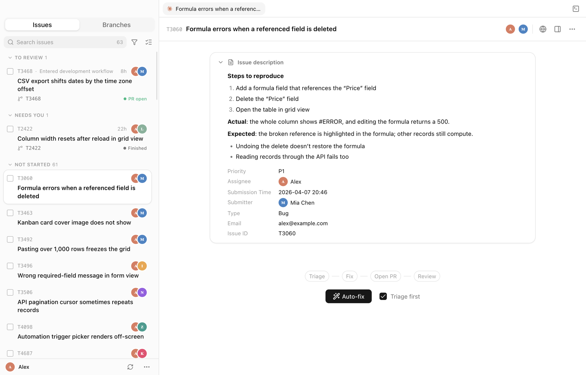

# TeaBranch

English | [简体中文](README.zh-CN.md)

A macOS app for working on [Teable](https://github.com/teableio/teable) in parallel. Every branch lives in its own Git worktree with its own dev server, ports, database and environment. Point it at a Teable issue table and it goes one step further: a local agent triages each issue, fixes it in its own worktree, opens the PR and gets it reviewed. What's left for you is the review.


<p align="center">
  
</p>

## What is TeaBranch?

Teable is a large full-stack project, and switching branches means restarting everything. TeaBranch keeps each branch checked out in its own worktree, so switching is a click and nothing has to restart. With several branches running side by side, issue fixing parallelises as well: each issue gets a worktree named after its ID, with its own agent conversation and its own terminal.

The window has three sections: **Issues** (⌘2), **Branches** (⌘1) and **Autopilot** (⌘3). The interface is in English or Chinese. It follows macOS by default, and you can switch it, along with the light or dark look, in Settings: the gear beside the section switcher (or ⌘,) opens them as a section of the window with a sidebar of their own — appearance, repository, terminal, models, the Issue auto-fix pages, and the way on to the Autopilot pages.

## Issues: agent-driven fixing

**From the issue table**

- Sign in to Teable (teable.ai by default) and pick your issue table from dropdowns: base → table → view. There are no links to paste. The title, description, status, assignee and ID fields are recognised automatically, and you can remap them.
- By default it shows **only your issues**, filtered server-side. Teable-style field filters narrow them further.
- Issues are grouped by where they stand: needs you, awaiting review, in progress, not started. Descriptions, comments and attachments render inline, and images open in a lightbox.

**Fixing**

- **自动修复** creates a worktree whose branch is exactly the issue ID (e.g. `T2312`), then hands the agent the full issue, attachments included.
- **Triage first** (on by default). Before touching code, the agent checks whether the issue was already fixed (git log, open PRs) and tries to reproduce it locally with a minimal failing test. It then decides whether it's a bug at all. Only a confirmed bug is fixed automatically. Anything else stops with its verdict (already fixed / not a bug / needs info), and you can still press **仍然修复** to fix it anyway.
- The agent finds the root cause, fixes it, and opens a PR that carries the issue ID.
- **Review**: Codex, or a local model through Magpie, reviews the PR. Its findings go back to the issue's agent, which addresses them for a configurable number of rounds.
- **Custom prompts**: the instructions for each stage (triage, fix, review, addressing review) can be rewritten, with placeholders such as `{key}` and `{branch}`. The issue itself is always included, and TeaBranch appends the `TRIAGE:` / `VERDICT:` line on its own, so a custom prompt can't break the pipeline.
- **Batches**: select several issues (or 全部修复) and they queue up N at a time. A notification arrives when the whole batch is done.

**Conversations**

- Each issue has its own Claude Code conversation, and you can interject at any point. The composer picks the model, effort level and access mode, and takes attachments.
- **+** opens another chat in the issue's worktree, building the worktree first if there isn't one. Chat tabs are grouped per issue, so switching issues switches tabs. You can also open free-standing chats in any worktree.
- A built-in terminal dock (⌘J to show or hide, ⌘\` for a new terminal) opens shells in the issue's worktree. Terminals are grouped per issue like the chats.
- While agents are running, the spark on the menu-bar icon breathes.

**Requirements:** [Claude Code](https://claude.com/claude-code) (`claude`) and the GitHub CLI (`gh`, signed in) on your `PATH`. Codex (`codex`) or Magpie are needed for review.

## Branches: worktrees and dev servers

**Worktrees**

- One-click creation (⌘N). It makes the worktree, generates an isolated `.env.development.local`, installs dependencies, provisions the database and runs migrations.
- Ports are allocated in blocks. Deleted worktrees' gaps are reused, and the allocator skips ports that predictably belong to something else (Postgres, Redis, macOS AirPlay's 5000 and 7000).
- A database can be created fresh, cloned from another worktree, or shared with one. By default new worktrees share the main checkout's database, which is what a branch cut from `develop` usually wants, and it skips the slowest steps.

**Running them**

- Each branch starts and stops independently.
- **Stop actually stops.** It kills by process group *and* by port, waits until the ports are really free, and tells you which PID is still holding one when they're not.
- A health watchdog supervises by port, not just by PID, so a dev-server wrapper that outlives its crashed inner app gets restarted.
- Dev servers still running after a force-quit are picked up again. Each branch shows CPU, memory, uptime and its process list.
- Logs show per source (backend, frontend) with ANSI colour and in-place search.

**Working on them**

- **Agent**, **Terminal** and **Code** open the worktree in your terminal or VS Code. With [Otty](https://otty.app) no Accessibility permission is needed.
- **Preview** opens the branch on a `<branch>.localhost` subdomain, so each branch gets its own cookie jar.
- Edit any variable in the worktree's env file; saving restarts the branch. An ngrok tunnel can be opened per branch.
- Lanes (developing / todo / done) keep the sidebar organised. Closing the window keeps the app running in the menu bar.

## Autopilot

Autopilot runs the issue pipeline without you at the keyboard. It listens to the issue table, to Feishu (as a bot, or as you) and to your GitHub pull requests; a router agent reads what comes in, answers in the thread, and opens issue agents for what needs code. Send it a pull request link in Feishu — in a group or a direct message — and it reviews the PR, posts the review on GitHub under your account (approve, request changes or comment, as the settings allow) and reports the verdict in the thread. Every source, the router and the workers have a page under **Autopilot**, with an activity feed of what happened.

## Install

### Homebrew

```bash
brew tap caoxing9/teabranch https://github.com/caoxing9/TeaBranch
brew trust --cask caoxing9/teabranch/teabranch
brew install --cask teabranch
```

Upgrade with `brew upgrade --cask teabranch`. The tap is added by URL because the cask lives in this repository.

The build is ad-hoc signed and not notarized. The cask strips the quarantine attribute in a `postflight`, so the app launches without right-click → Open. As a result, Gatekeeper doesn't vet it on your machine. Notarizing with a paid Developer ID would remove the need for that.

### Manual

Download `TeaBranch-<version>-arm64.dmg` from [Releases](https://github.com/caoxing9/TeaBranch/releases) and drag the app to Applications. Apple Silicon only. Because the build isn't notarized, either right-click → Open the first time, or run:

```bash
xattr -d com.apple.quarantine /Applications/TeaBranch.app
```

## Build from source

The app is TSX on [nsh](https://nsh.dev) with a Rust crate of its own, in [`app-nsh/`](app-nsh):

```bash
git clone git@github.com:caoxing9/TeaBranch.git
cd TeaBranch/app-nsh
nsh run --target macos          # run with hot reload
nsh package --target macos      # → .nsh/out/TeaBranch.app
```

Requirements: Rust 1.93 or later and nsh 0.4 (`curl -fsSL https://nsh.dev/install.sh | NSH_VERSION=v0.4.0 sh`).

| Command | What it does |
|---------|--------------|
| `nsh check` | cargo check of the crate, then TypeScript |
| `nsh test` | cargo test, then every test file, headless |
| `nsh test --target macos e2e` | the end-to-end tests in a real window |
| `nsh package --target macos` | the `.app`, ad hoc signed, with the icon |

CI typechecks, runs the unit and smoke tests and packages the app on every pull request; the release workflow packages it into the DMG.

Stack: nsh (Rust core, AppKit host, QuickJS for TSX), TypeScript, Tailwind classes. The services (`src/core`, `src/services`) own git, processes, ports, agents, Teable, Feishu and GitHub; the screens (`src/ui`) call them through one typed object (`src/api.ts`); the Rust crate (`native/`) provides what TSX can't reach. Chinese is the source language for UI text, with English in `src/shared/i18n/en/`; a test catches missing translations. [`app-nsh/README.md`](app-nsh/README.md) has the layout and how to run a development build beside the installed app.

The previous Electron build is in [`app/`](app), kept as the reference for what is still being ported; the earlier native build is in [`swift/`](swift).

## How worktree isolation works

Creating a worktree:

1. **Fetches** the latest `origin/develop`.
2. **Creates** a Git worktree in a sibling directory (`<repo>-worktree/<branch-name>`).
3. **Generates** a `.env.development.local` with a unique port block, a database and a Redis DB index.
4. **Installs** dependencies via `pnpm install`.
5. **Provisions** the database: new, cloned, or shared with another worktree.
6. **Runs** migrations.

Ports come from a "slot" that fixes the whole block (`3000 + slot*100`). Slot assignment reads the real port values off disk rather than trusting the `# WORKTREE_SLOT=` markers. The two drift apart whenever a derived port was already taken, and trusting the marker hands the same port to two worktrees, which then kill each other's dev servers. The search starts from the first slot, so a deleted worktree's block gets reused.

## Configuration

Everything lives in `~/Library/Application Support/com.teabranch.dev/`. That's the same directory the earlier builds used, so an existing install keeps its state. Settings are edited in the app: the gear beside the section switcher (⌘,) opens them, with the app's own pages, **Models** (a model per scene — fixing, checking, review, chats, the router — and a fallback for the rest, like a proxy's rules) and the Issue auto-fix pages in one sidebar; autopilot's settings stay on its own pages, linked from there.

| File | Holds |
|------|-------|
| `settings.json` | Repository path, base port, default start command, terminal app, agent command, language |
| `categories.json` | Lane assignments |
| `teable.json` | Issue table and field mapping, triage, models, review engine, batch size, custom prompts |
| `autopilot.json` | Sources (Teable, Feishu, GitHub), the router, workers, PR review |

Teable and Feishu credentials are kept in the macOS keychain, not in these files. The Electron build kept them under its own key, so the first start of this build asks you to sign in again.

## Contributing

1. Fork the repository and create a feature branch.
2. Commit using [Conventional Commits](https://www.conventionalcommits.org/). `feat:` and `fix:` drive the release version.
3. Open a pull request. CI lints, typechecks, tests and builds the app.

**Title the PR with a Conventional Commits prefix.** Merges are squashed, and GitHub uses the *PR title* as the commit subject. A PR called "Rebuild the interface" lands on `main` as a commit semantic-release doesn't recognise, so no release is cut.

## License

MIT
