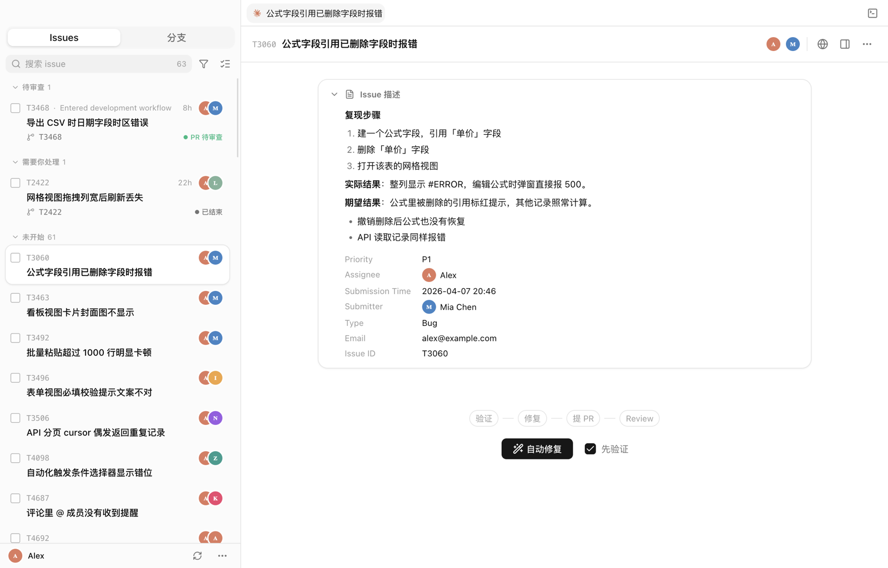

# TeaBranch

[English](README.md) | 简体中文

TeaBranch 是一个 macOS app，用来并行开发 [Teable](https://github.com/teableio/teable)。每个分支有自己的 Git worktree、dev server、端口、数据库和环境变量，互不干扰。把它接到 Teable 的 issue 表上，还能更进一步：本地 agent 逐个验证 issue，在各自的 worktree 里修复、提 PR、拉人 review，你只需要审查。


<p align="center">
  
</p>

## 为什么需要它

Teable 是个很大的全栈项目，切一次分支就得把所有东西重启一遍。TeaBranch 让每个分支常驻在自己的 worktree 里，切换只要点一下，什么都不用重启。分支既然能同时跑好几个，修 issue 也就能并行：每个 issue 一个以 issue ID 命名的 worktree，有自己的 agent 对话和终端。

窗口分两块：**分支**（⌘1）和 **Issues**（⌘2）。界面支持中文和英文，默认跟随系统语言，可以在设置（⌘,）里切换。

## Issues：agent 自动修复

**从 issue 表开始**

- 登录 Teable（默认 teable.ai），直接用下拉框选 Base → 表 → 视图，不用复制粘贴链接；标题、描述、状态、负责人、ID 等字段会自动识别，也可以手动映射。
- 默认**只看分配给我的**，在服务端过滤；还可以用 Teable 风格的字段筛选进一步缩小范围。
- issue 按状态分组：需要你处理、待审查、进行中、未开始。描述、评论和附件直接在 app 里渲染，图片可以点开放大。

**修复流程**

- 点 **自动修复**，TeaBranch 会建一个分支名就是 issue ID 的 worktree（比如 `T2312`），把完整的 issue 交给 agent，附件也一起带上。
- **先验证**（默认开启）。动代码之前，agent 会先确认三件事：
  1. 是否已经修过了：查 git log 和已合并的 PR；
  2. 能不能在本地复现：最好写一个会失败的最小测试；
  3. 到底是不是 bug。

  只有确认是 bug 才会自动修。其他情况（已修复 / 不是 bug / 信息不足）会停下来，把结论交给你决定，你仍然可以点 **仍然修复**。
- agent 定位根因、修复，然后提一个带 issue ID 的 PR。
- **Review**：由 Codex，或通过 Magpie 调用的本地模型来 review PR。review 意见会回传给这个 issue 的 agent，由它处理，轮数可以设置。
- **批量修复**：勾选多个 issue，或者直接点「全部修复」，它们会按批次排队，每批 N 个。整批完成后会发通知给你。
- **自定义 Prompt**：验证、修复、review、处理 review 意见这几个阶段的指令都可以改写，支持 `{key}`、`{branch}` 这类占位符。issue 本身的信息总是自动带上，判定行（`TRIAGE:` / `VERDICT:`）由 TeaBranch 固定追加，所以改 prompt 不会把流程搞坏。

**对话**

- 每个 issue 有自己的 Claude Code 对话，随时可以插话。输入框里可以选模型、推理强度和权限模式，也能加附件。
- 点 **+** 会在这个 issue 的 worktree 里再开一个对话，还没有 worktree 就先建好。对话标签按 issue 分组，切换 issue 时标签跟着切换。也可以在任意 worktree 里开不属于任何 issue 的独立对话。
- 内置终端面板：⌘J 显示或隐藏，⌘\` 新开一个终端。终端在当前 issue 的 worktree 里打开，和对话一样按 issue 分组。
- 有 agent 在跑时，菜单栏图标上的星星会呼吸闪动。

**依赖**：`PATH` 里需要有 [Claude Code](https://claude.com/claude-code)（`claude`）和已登录的 GitHub CLI（`gh`）。review 还需要 Codex（`codex`）或 Magpie。

## 分支：worktree 和 dev server

**Worktree**

- 一键创建（⌘N）：建 worktree、生成独立的 `.env.development.local`、装依赖、准备数据库、跑 migration。
- 端口按块分配。删掉的 worktree 空出来的端口块会被复用。分配时会跳过注定被别的程序占用的端口，比如 Postgres、Redis，以及 macOS AirPlay 用的 5000 和 7000。
- 数据库可以新建、从别的 worktree 克隆，或者直接共享。新 worktree 默认共享主仓库的数据库。从 `develop` 切出来的分支一般都是这么用的，而且能跳过最慢的几步。

**运行**

- 每个分支单独启动和停止。
- **停止就是真停止**：同时按进程组和端口来杀，一直等到端口真正释放。如果端口还被占着，会告诉你是哪个 PID。
- 健康检查按端口来判断，不只看 PID。所以如果 dev server 的外层进程还在、里面的 app 已经崩了，也会被重启。
- 强制退出后还在跑的 dev server，下次启动会重新接管。每个分支都会显示 CPU、内存、运行时长和进程列表。
- 日志按来源分标签（backend、frontend），保留 ANSI 颜色，支持就地搜索。

**开发**

- **Agent**、**Terminal**、**Code** 三个按钮分别在终端或 VS Code 里打开 worktree。配合 [Otty](https://otty.app) 使用时不需要辅助功能权限。
- **Preview** 用 `<branch>.localhost` 子域名打开分支，所以每个分支的 cookie 互不干扰。
- 可以编辑 worktree 环境变量文件里的任意变量，保存后分支自动重启。每个分支都能单独开一个 ngrok 隧道。
- 侧栏按泳道（开发中 / 待开发 / 已完成）整理分支。关掉窗口后 app 留在菜单栏里继续运行。

## 安装

### Homebrew

```bash
brew tap caoxing9/teabranch https://github.com/caoxing9/TeaBranch
brew trust --cask caoxing9/teabranch/teabranch
brew install --cask teabranch
```

升级用 `brew upgrade --cask teabranch`。cask 就放在这个仓库里，所以 tap 时要带上仓库地址。

安装包是 ad-hoc 签名，没有经过公证。cask 会在 `postflight` 里去掉隔离属性，所以第一次打开时不用右键 → 打开。代价是 Gatekeeper 不会在你的机器上检查这个 app。以后用付费的 Developer ID 做公证，就不需要这一步了。

### 手动安装

从 [Releases](https://github.com/caoxing9/TeaBranch/releases) 下载 `TeaBranch-<version>-arm64.dmg`，把 app 拖进「应用程序」。只支持 Apple Silicon。安装包没有公证，第一次打开时要么右键 → 打开，要么运行：

```bash
xattr -d com.apple.quarantine /Applications/TeaBranch.app
```

## 从源码构建

app 用 Electron + React 写成，代码在 [`app/`](app) 目录：

```bash
git clone git@github.com:caoxing9/TeaBranch.git
cd TeaBranch/app
pnpm install
pnpm dev            # 开发模式，带热更新
pnpm dist           # → dist/TeaBranch-<version>-arm64.dmg
```

需要 Node 22 和 pnpm 10。

| 命令 | 作用 |
|------|------|
| `pnpm lint` | oxlint，有 warning 也算失败 |
| `pnpm format` / `pnpm format:check` | oxfmt 格式化 / 检查 |
| `pnpm typecheck` | TypeScript 类型检查，覆盖主进程和渲染进程 |
| `pnpm test` | Vitest |

每个 PR 都会在 CI 上跑以上全部检查，再做一次生产构建。

技术栈：Electron、electron-vite（Vite）、React 19、TypeScript、Tailwind 4、基于 Base UI 的 shadcn/ui、zustand、xterm.js + node-pty。

- **主进程**（`src/main`）负责 git、进程、端口、agent 和 Teable。
- **渲染进程**（`src/renderer`）通过一个有类型的 IPC 通道和主进程通信，接口定义在 `src/shared/types.ts`。
- **文案**：中文是源语言，英文翻译在 `src/shared/i18n/en/`。测试会检查有没有漏翻。

早期的原生版本在 [`swift/`](swift)。

## worktree 是怎么隔离的

创建一个 worktree 时，TeaBranch 会：

1. **拉取**最新的 `origin/develop`。
2. **创建**一个 Git worktree，放在同级目录 `<repo>-worktree/<branch-name>`。
3. **生成** `.env.development.local`，分配独立的端口块、数据库和 Redis DB 编号。
4. 用 `pnpm install` **安装**依赖。
5. **准备**数据库：新建、克隆，或者和别的 worktree 共享。
6. **运行** migration。

端口由一个「slot」决定，一个 slot 对应一整块端口（`3000 + slot*100`）。分配 slot 时，TeaBranch 直接读磁盘上实际写的端口，不信 `# WORKTREE_SLOT=` 这个标记。原因是：如果某个派生端口当时已被占用，标记和实际端口就会对不上；这时信标记，就会把同一个端口分给两个 worktree，它们的 dev server 会互相杀掉对方。搜索从第一个 slot 开始，所以删掉的 worktree 空出来的端口块会被复用。

## 配置

所有数据都放在 `~/Library/Application Support/com.teabranch.dev/`。这和早期版本用的是同一个目录，所以老用户升级后状态都还在。设置都在 app 里改：分支相关的按 ⌘,，issue 相关的在 **Issue 设置…** 里。

| 文件 | 内容 |
|------|------|
| `settings.json` | 仓库路径、起始端口、默认启动命令、终端 app、agent 命令、界面语言 |
| `categories.json` | 分支的泳道分组 |
| `teable.json` | issue 表和字段映射、修复前验证、模型、review 引擎、批次大小、自定义 Prompt |

Teable 的登录凭据用 macOS 钥匙串加密保存（Electron `safeStorage`），不写进上面这些文件。

## 参与贡献

1. Fork 仓库，新建一个功能分支。
2. commit 遵循 [Conventional Commits](https://www.conventionalcommits.org/)，`feat:` 和 `fix:` 决定发版的版本号。
3. 提 PR。CI 会做 lint、类型检查、测试和构建。

**PR 标题要带 Conventional Commits 前缀。** 合并方式是 squash，GitHub 会拿 *PR 标题* 当 commit 标题。如果 PR 叫「重做界面」，合进 `main` 的 commit 就无法被 semantic-release 识别，也就不会发版。

## 许可证

MIT
